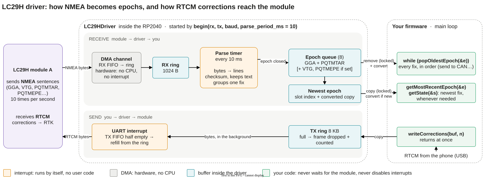

# GNSS LC29H (Quectel)

Driver for the Quectel LC29H GNSS module (tested with the LC29H EA, dual-antenna RTK with heading), and the tools
to configure the module and check that everything works.

1. [Overview](#1-overview)
2. [Example: epochs and RTK corrections](#2-example-epochs-and-rtk-corrections)
3. [Epochs](#3-epochs)
4. [RTK corrections](#4-rtk-corrections)
5. [Simple use: getState()](#5-simple-use-getstate)
6. [Counters](#6-counters)
7. [Module configuration](#7-module-configuration)
8. [Debug tools](#8-debug-tools)
9. [Testing](#9-testing)
10. [Reference](#10-reference)

---

## 1. Overview

The module prints NMEA sentences on a UART, several per fix (10 fixes/s on the LC29H EA), and takes RTK
corrections (RTCM 3) on the same UART. The driver:

- **owns the UART** (`begin()`): it sets it up with the FIFOs on, receives with **one DMA channel** into its
  own ring (no interrupt per byte, so no byte waits for the CPU) and owns the UART interrupt (corrections);
- **parses the sentences** as they arrive and groups those of the same fix into an **epoch** (position, speed,
  heading, position error), kept in a queue until the firmware pops it;
- **sends corrections** without blocking: `writeCorrections()` queues them and the UART interrupt sends them;
- **counts** everything that can go wrong (bytes lost, checksum errors, epochs incomplete or dropped).

| File | What |
|---|---|
| `software/drivers/include/rp_agrolib_lc29h.h` | API (every method is documented there) |
| `software/drivers/src/rp_agrolib_lc29h.cpp` | implementation |
| `software/examples/src/rp_lc29h_debug.cpp` | debug firmware (section 8) |
| `software/scripts/lc29h/` | PC tools: bench run, analysis, its test (sections 8, 9) |

Two libraries are built from the same source:

| Library | Use |
|---|---|
| `rp_agrolib_lc29h` | production |
| `rp_agrolib_lc29h_debug` | debugging only: adds timing fields and the debug line formats (`LC29H_DEBUG_TIMING`, section 8) |

---

## 2. Example: epochs and RTK corrections

How the driver works: the module's NMEA bytes become epochs, and the RTCM corrections go back to the module
(source: `img/lc29h_driver_overview.drawio`).



A firmware that takes the module's fixes as epochs and passes RTK corrections to the module. Here the corrections
come from USB (e.g. a PC or phone running an NTRIP client); from a radio or another UART it is the same call.

```cpp
#include "pico/stdlib.h"
#include "rp_agrolib_lc29h.h"

#define GNSS_RX_PIN 1
#define GNSS_TX_PIN 0
#define GNSS_BAUDRATE 460800

static LC29HDriver gnss(uart0);

// Pass whatever correction bytes arrived on USB to the module. writeCorrections() only copies them into the
// driver's TX ring and returns; the UART interrupt sends them
static void forward_corrections() {
    static uint8_t buf[512];
    uint16_t n = 0;
    int c;
    while (n < sizeof(buf) && (c = getchar_timeout_us(0)) != PICO_ERROR_TIMEOUT) {
        buf[n++] = (uint8_t) c;
    }
    if (n > 0) {
        gnss.writeCorrections(buf, n);
    }
}

int main() {
    stdio_init_all();

    gnss.setEpochSentences(GNSS_SENTENCE_DEFAULT);  // GGA + PQTMTAR; add GNSS_SENTENCE_VTG for the speed
    // UART, RX DMA channel, rings, UART interrupt, and a timer that parses what arrives every 10 ms
    if (!gnss.begin(GNSS_RX_PIN, GNSS_TX_PIN, GNSS_BAUDRATE)) {
        printf("UART0 interrupt already in use, or no DMA channel or timer free\n");
    }

    while (true) {
        // Every epoch waiting in the queue: usually 0 or 1, several after a burst or a busy loop
        GnssEpoch e;
        while (gnss.popOldestEpoch(&e)) {
            if (e.flags_ & GNSS_VALID_POSITION) {
                printf("fix %u utc %lu ms: %.8f %.8f quality %u\n", e.seq_, (unsigned long) e.utc_ms_, e.latitude_,
                       e.longitude_, e.fix_quality_);
            }
            if (e.flags_ & GNSS_VALID_HEADING) {
                printf("  heading %.2f deg, quality %u\n", e.heading_, e.heading_quality_);
            }
        }
        forward_corrections();
    }
}
```

Link `rp_agrolib_lc29h` (it brings `rp_agrolib_uart` and `pico_stdlib`).

### What runs where
| Where | What |
|---|---|
| DMA channel (driver, hardware) | moves every received byte into the RX ring as it arrives: no CPU, no interrupt |
| UART interrupt (driver) | refills the UART with queued corrections |
| Timer interrupt (driver), every `parse_period_ms` | assembles the new sentences, checks their checksum and stores the ones it uses **as text** (no conversion to numbers: kept short); closes complete epochs into the queue |
| `popOldestEpoch()` / `getMostRecentEpoch()` / `getState()` (firmware) | copy the stored text, then convert it to numbers (`atof`, degrees, flags) in the caller's context |
| Firmware (main loop, or anywhere) | the three above, `writeCorrections()`, settings, `stats()` |

`begin()`'s last argument is the parse period, `LC29H_PARSE_PERIOD_MS` (10 ms) by default. It must stay much
shorter than the epoch timeout (90 ms), which is only checked when the parse runs, and than what the RX ring holds
(~0.3 s at 10 Hz); much shorter than 10 ms only adds interrupts. At other fix rates, change it together with
`setEpochTimeoutMs()`.

The parse runs in an interrupt, so it is kept as short as possible: sentences the driver doesn't use (RMC, GLL,
GSA, GSV…, most of what the module sends) are skipped after their 6-character header, and the ones it uses (GGA,
PQTMTAR, PQTMEPE, VTG) are only checked and copied. Converting text to numbers is slow on the RP2040, which has no
floating-point unit, so it happens in the methods that read the epochs instead.

### Why the driver disables interrupts inside `popOldestEpoch()`
The epoch queue is used from two places at once:
- **the parse, in the timer interrupt,** adds epochs: it writes an epoch into the queue's array and increments
  its count (or, when the queue is full, drops the oldest: moves the head and decrements the count);
- **`popOldestEpoch()`, in the firmware,** removes the oldest: it copies it out (the stored sentences, ~600 bytes,
  copied in many steps), then moves the head and decrements the count.

An interrupt can stop the firmware between any two instructions. If the parse ran while `popOldestEpoch()` is half way
through:
- with the queue full, the epoch being copied can be overwritten mid-copy (the new epoch goes into the slot of
  the oldest), and the firmware gets half of one fix and half of another;
- both sides update the count with a read-modify-write (`count - 1` in the firmware, `count + 1` in the parse).
  If the parse runs between the firmware's read and its write, the firmware writes back a stale value: the
  parse's change is lost and the count no longer matches the queue (an epoch vanishes or an old one comes back).

So `popOldestEpoch()` copies the epoch and updates the count inside a **critical section**
(`critical_section_enter_blocking()` … `critical_section_exit()`, from `pico/critical_section.h`). It disables
interrupts on the calling core and takes a hardware spin lock, so the parse can't run in between, on this core or
the other one. It lasts a few microseconds (only bytes are copied; the conversion to numbers comes after, outside
it). An interrupt that becomes due meanwhile is not lost: it runs right after. The parse holds the same lock only
while it writes into the queue, and `getMostRecentEpoch()`, `getState()` and the setters use it too. The firmware
never needs to disable interrupts itself.

### Rules
- **Call `begin()` once**, before the other calls except the settings. It returns `false` if the UART's interrupt
  already has a handler (the firmware must not install its own with `uart_enable_interrupt()` on that UART), no
  DMA channel or no timer is free. One driver per UART.
- **The driver uses one DMA channel** (of the RP2040's 12), claimed in `begin()` with
  `dma_claim_unused_channel()`. Other code must claim its channels the same way, not use fixed channel numbers.
- **With `popOldestEpoch()`, pop often enough:** the queue holds 8 (0.8 s at 10 Hz); beyond that the oldest are
  dropped (`stats().overwritten`). Firmware that only reads the newest fix ignores this counter.
- **Nothing else may write to this UART's TX**, or its bytes get mixed into the corrections.
- **Manual mode** (`begin(rx, tx, baud, 0)`): no timer; the firmware calls `process(now_ms)` itself, every ~10 ms
  (e.g. from its main loop or its own timer). For firmware that must control when the parse runs.

---

## 3. Epochs

An epoch is one fix: the sentences the module prints for it, parsed into one `GnssEpoch`.

| Sentence | Gives | `GnssEpoch` fields |
|---|---|---|
| `$GNGGA` | time, position, altitude, fix quality, satellites | `utc_ms_`, `latitude_`, `longitude_`, `altitude_`, `fix_quality_`, `num_satellites_` |
| `$GNVTG` | speed over ground | `speed_kph_` |
| `$PQTMTAR` | heading from the two antennas | `heading_`, `heading_quality_`, `heading_acc_`, `baseline_m_` |
| `$PQTMEPE` | estimated position error | `epe_north_`, `epe_east_`, `epe_down_` |

- **Only use a field if its flag is set** in `flags_` (`GNSS_VALID_POSITION`, `_ALTITUDE`, `_SPEED`, `_HEADING`,
  `_HEADING_ACC`, `_EPE`, `_TIME`). For example, position is valid only with a fix (quality ≥ 1); heading only with heading quality ≥ 1.
- `sentences_` says which sentences arrived (`GNSS_SENTENCE_GGA`, `_VTG`, `_PQTMTAR`, `_PQTMEPE`).
- `seq_` numbers the closed epochs (+1 each, wraps at 255): a gap means an epoch was dropped.
- Fix quality (`fix_quality_`, `heading_quality_`): 0 invalid, 1 GPS, 2 DGPS, 4 RTK fixed, 5 RTK float.

### How an epoch closes
A GGA opens the epoch; the other sentences join the open one. It closes, with `close_reason_`:

| `close_reason_` | When |
|---|---|
| `GNSS_CLOSE_COMPLETE` | every sentence of the set arrived (normal) |
| `GNSS_CLOSE_NEXT_GGA` | the next fix's GGA arrived first |
| `GNSS_CLOSE_REPEAT` | a second copy of a sentence arrived (e.g. this fix's GGA was lost) |
| `GNSS_CLOSE_TIMEOUT` | the timeout passed since it opened (default 90 ms) |

Closed epochs wait in a queue of 8 (oldest first). If the queue is full, the oldest is dropped and counted
(`stats().overwritten`).

### Reading epochs
| Method | Gives | Queue |
|---|---|---|
| `popOldestEpoch()` | every fix in order: call it in a loop until it returns `false` | removes the epoch |
| `getMostRecentEpoch()` | the newest fix, whenever needed (a new one has a new `seq_`) | unchanged |
| `getState()` | the newest fix as `RtkState` (section 5) | unchanged |

### The sentence set
`setEpochSentences(mask)` says which sentences make up an epoch. GGA is always included.

| Set | Use |
|---|---|
| `GNSS_SENTENCE_DEFAULT` (GGA + PQTMTAR), **default** | position + heading |
| `GNSS_SENTENCE_DEFAULT \| GNSS_SENTENCE_VTG` | also the speed (`getState()` needs it for `speed_kph_`) |
| `GNSS_SENTENCE_ALL` (+ VTG, PQTMEPE) | also the position error. The module must be configured to send `$PQTMEPE` (section 7) |
| `GNSS_SENTENCE_GGA` | position only, no wait for the heading |

The set must match what the module sends:

| Set (driver) | Module sends | Epoch closes | Result |
|---|---|---|---|
| default | GGA + VTG + TAR | at TAR, ~50 ms after GGA | position + heading (VTG ignored) |
| default | GGA + VTG + TAR + EPE | at TAR | VTG, EPE ignored (counted in `stats()`, never in the epoch) |
| ALL | GGA + VTG + TAR + EPE | at the last of them (TAR) | position, speed, heading, EPE |
| ALL | GGA + VTG + TAR (no EPE) | **timeout, 90 ms after GGA** | works, ~40 ms later; every close is `TIMEOUT`: the mismatch shows in the counters |
| GGA only | anything | at GGA | position only |

### The timeout
`setEpochTimeoutMs(ms)`, default `GNSS_EPOCH_TIMEOUT_MS` (90 ms). It must be **above** the delay between GGA and
the last sentence of the set (PQTMTAR arrives ~50 ms after GGA on the LC29H EA) and **below** the fix period
(100 ms at 10 Hz). Change it only if the module runs at another rate.

---

## 4. RTK corrections

```cpp
gnss.writeCorrections(frame, len);   // len up to 65535; returns at once
```

After `begin()`, the frame is copied into the driver's TX ring (`LC29H_TX_RING_SIZE`, 8 KB) and the UART
interrupt sends it (~22 ms per 1 KB at 460800 baud) while the program goes on. If the ring has no room, the
**whole frame is dropped** and counted (`stats().rtcm_dropped`): a lost correction is replaced by the next one
(~1 s later), and at ~1 KB/s in and ~46 KB/s out this is never expected.

Without `begin()`, `writeCorrections()` behaves as before: it writes the frame and waits until it is sent.

---

## 5. Simple use: getState()

```cpp
RtkState rtk;
gnss.getState(&rtk);   // after begin(), whenever needed
```
The newest epoch as `RtkState` (the struct of the old `getNMEA()`): every field comes from the same fix. A field
that is not valid in that epoch (e.g. the position without a fix) keeps its previous value; all are 0 until the
first epoch. For the validity flags, use `getMostRecentEpoch()`.

---

## 6. Counters

`stats()` returns `LC29HStats`, cumulative since start (32-bit reads are atomic on the RP2040).

| Counter | Means | Should be |
|---|---|---|
| `rx_bytes` | bytes received from the module | ~3 KB/s at 10 Hz |
| `uart_overrun` | parse periods in which the UART lost bytes (its FIFO was full). With the DMA it should never happen | 0 |
| `uart_framing_break` | parse periods with framing/break errors (wrong baud rate, wiring) | 0 |
| `dma_restarts` | the RX DMA started again before its transfer count ran out (the RP2040 DMA stops at 0): every ~5 days | – |
| `rx_dropped` | bytes dropped: the DMA went round the RX ring before they were parsed (parse calls too rare) | 0 |
| `lines`, `long_lines` | lines assembled; lines too long (garbage) | `long_lines` 0 |
| `ok_*`, `bad_*` | sentences with a valid / failed checksum, by type. `ok_other`: VTG, plus the sentences the driver doesn't use (skipped after their header, checksum not checked) | `bad_*` 0 |
| `closed[GNSS_CLOSE_*]` | epochs closed, by reason | mostly `COMPLETE` |
| `overwritten` | epochs dropped before `popOldestEpoch()` (queue full) | 0 if the firmware pops epochs |
| `rtcm_bytes`, `rtcm_dropped` | correction bytes queued; frames dropped (TX ring full) | `rtcm_dropped` 0 |

---

## 7. Module configuration

The driver does not configure the module: the module's settings are saved in its own flash, and are set once
with a script, over a serial port connected to the module (default 460800 baud).

The sentence set (section 3) must match what the module sends. Two configurations:

| Configuration | For | Commands |
|---|---|---|
| **default** | `GNSS_SENTENCE_DEFAULT` (+ `_VTG`) | `$PQTMRESTOREPAR*13` (factory settings, which send GGA and VTG), `$PQTMCFGMSGRATE,W,PQTMTAR,1,1*09` (heading on every fix), `$PQTMSAVEPAR*5A` (save) |
| **with EPE** | `GNSS_SENTENCE_ALL` | the above, plus `$PQTMCFGMSGRATE,W,PQTMEPE,1,2*1D` (`$PQTMEPE` version 2 on every fix) before `$PQTMSAVEPAR*5A` |

Useful extras:
- `$PQTMCFGMSGRATE,W,PQTMEPE,0,2*1C` turns `$PQTMEPE` off explicitly (then `$PQTMSAVEPAR*5A`).
- Read a setting back: `$PQTMCFGMSGRATE,R,PQTMEPE,2*05` (answer `$PQTMCFGMSGRATE,OK,PQTMEPE,1,2*4E` when on),
  `$PQTMCFGMSGRATE,R,PQTMTAR,1*11`.
- The module answers every command (e.g. `$PQTMCFGMSGRATE,OK*29`); the scripts print every line received.
- A module set up "with EPE" keeps sending `$PQTMEPE` after a power cycle until it is reconfigured. If it still
  sends it after the default configuration, also send the "off" command above.

Scripts: `configure_lc29he_heading.py` in the tl.heart repository (`scripts/`). It asks for the serial port and
baud rate and sends the commands of one of the configurations above. Check what the module sends afterwards with
the debug firmware in sniffer mode (section 8).

---

## 8. Debug tools

Everything here is for testing and debugging; nothing of it is needed in production.

### Debug library
Link `rp_agrolib_lc29h_debug` instead of `rp_agrolib_lc29h`. It defines `LC29H_DEBUG_TIMING` for the library and
the firmware alike (it changes the struct layout: never define it only in the firmware). It adds:

- in `GnssEpoch`: `opened_ms_`, `closed_ms_`, `tar_after_ms_`, `epe_after_ms_` (when each sentence arrived);
- in `LC29HStats`: `irq_max_us` (longest UART interrupt: corrections), `rx_ring_max_pending` (fullest RX ring),
  `parse_max_us`, `parse_gap_max_us` (the parse timer);
- `formatEpochDebugLine()` and `formatStatsDebugLines()`: the lines below, written into a buffer. The driver
  never prints; the firmware decides where the lines go.

### Debug firmware: `rp_lc29h_debug`
`software/examples/src/rp_lc29h_debug.cpp`, built as two examples:

| Example | Mode | Shows |
|---|---|---|
| `rp_lc29h_debug` | epoch | the driver: one `E` line per epoch, `D*` counters every 5 s, `S` check every 1 s |
| `rp_lc29h_sniffer` | sniffer (`LC29H_DEBUG_SNIFFER`) | the module: every line it sends, with the time of its end; no driver |

Comparing the two separates "the module does not send it" from "the driver loses it". Both take corrections from
USB, framed as the phone app does (`$=` + 2-byte little-endian length + payload), so a PC can play the phone.
The epoch mode also takes `$#<h>` (h = one hex digit 1..f, `GNSS_SENTENCE_*` bits) to change the sentence set without
reflashing.

- **Default UART:** uart0, TX pin 0, RX pin 1, 460800 baud. Change with `UART_ID`, `UART_TX_PIN`, `UART_RX_PIN`,
  `UART_BAUDRATE`.
- **Boards:** the example only starts USB (`lc29h_debug_board_start()`, weak). A board that needs more before USB
  works (e.g. USB-C power delivery) builds the example from its own repository, with a file that defines
  `lc29h_debug_board_start()`.
- **Build:** `software/scripts/build.sh`, then flash `rp_lc29h_debug.uf2` / `rp_lc29h_sniffer.uf2` (BOOTSEL +
  copy to `RPI-RP2`).

### Lines on USB
Epoch mode:

`E,seq,utc_ms,sentences,flags,close_reason,opened_ms,tar_after_ms,epe_after_ms,close_after_open_ms,take_after_close_ms,done_after_take_ms`

One per epoch. `sentences`/`flags` in hex; 65535 = not received; times in the RP2040's ms (modulo 10⁷). The last
two fields come from the firmware: in the example `done` = 0 (printed); a firmware that sends epochs elsewhere
reports how long that took, or −1 if it did not send.

Every 5 s (counters cumulative, maxima since the previous report):

| Line | Fields |
|---|---|
| `DU` | t, rx_bytes, uart_overrun, uart_framing_break, rx_ring_max_pending, irq_max_us |
| `DS` | t, lines, ok_gga, ok_tar, ok_epe, ok_other, long_lines |
| `DB` | t, checksum failed: gga, tar, epe, other |
| `DC` | t, closed: complete, next_gga, repeat, timeout; overwritten |
| `DL` | t, rx_dropped, rtcm_bytes, rtcm_dropped, parse_max_us, parse_gap_max_us |

`S,t,seq,flags,fix,lat,lon,alt,speed_kph,heading,checks,skipped,epoch_mismatch,state_mismatch`, every 1 s: every
100 ms the example compares `getMostRecentEpoch()` (converted and cached copy) with the last epoch popped, and
`getState()` with that epoch's valid fields (the others kept). The fields after `seq`/`flags` are `getState()`'s;
the counters are cumulative and both mismatches must stay 0 (`report.yaml`: `newest_epoch_checks`).

Sniffer mode: `N,<t_us>,<NMEA line>`, and every 5 s
`D,t_us,bytes,lines,uart_overrun,uart_framing_break,ring_overflow,ring_max,too_long,rtcm_frames,rtcm_bytes`.

### PC tools: `software/scripts/lc29h/`
Python 3 with `pyserial`, `pyyaml`, `pandas`, `numpy`.

| Script | What |
|---|---|
| `gnss_bench.py` | the PC plays the phone: NTRIP client to the caster → corrections over USB; records every USB line (`usb.log`, `ntrip.log`, `meta.yaml`) |
| `gnss_bench_analyze.py` | one run → `report.yaml` + `epochs.csv` (epoch mode) or `fixes.csv` (sniffer mode); several runs → a table |
| `test_gnss_bench_analyze.py` | synthetic runs with known losses: the analyzer must find every one (`ALL PASSED`) |

NTRIP settings go in a file outside any repository, e.g. `~/.config/mx01/ntrip.yaml` (`host`, `port`,
`mountpoint`, `user`, `password`).

```bash
cd software/scripts/lc29h
python3 gnss_bench.py --ntrip-check 15        # caster reachable? RTCM message types received
python3 gnss_bench.py --port /dev/ttyACM0 --step "C all rtcm on" --firmware rp_lc29h_debug \
    --duration 300 --out ~/gnss_runs --sentences 15 [--no-ntrip]
python3 gnss_bench_analyze.py ~/gnss_runs/<run> [~/gnss_runs/<run> ...]
python3 test_gnss_bench_analyze.py
```

`--out` is required and must be outside the repository: runs are data, not code.

Board-specific stages (e.g. CAN and a ROS bridge on a robot) extend the scripts without copying them:
`gnss_bench.run(args, on_start, on_stop)` and `gnss_bench_analyze.analyze(run, extend)`.

---

## 9. Testing

Each step is one ~5 min run (`--duration 300`), module antennas outdoors, then `gnss_bench_analyze.py`. Module
configured "with EPE" (section 7) unless noted.

| Step | Firmware | Corrections | Checks | Pass when |
|---|---|---|---|---|
| A | `rp_lc29h_sniffer` | on | what the module sends | `sentences_per_s`: GNGGA, GNVTG, PQTMTAR, PQTMEPE ≈ 10; `missing_pct_of_bursts` ≈ 0; overrun 0 |
| B | `rp_lc29h_debug`, `--sentences 3` | on | default set | `close_reasons` all `complete`; no epoch with flag 0x08 (EPE); PQTMTAR `arrival_after_gga_ms` ≈ 50 |
| C | `rp_lc29h_debug`, `--sentences 15` | on | full set, corrections | all `complete`; criteria below; RTK float/fixed reached |
| D | `rp_lc29h_debug`, `--sentences 15`, module in the **default** configuration | on | mismatch shows | every close `timeout`; `ok.epe` = 0 |
| E | `rp_lc29h_debug` | off (`--no-ntrip`) | without corrections | criteria below |

Criteria for an epoch-mode run (`report.yaml`):

| Key | Pass | If not |
|---|---|---|
| `epochs_closed_by_rp2040` = `fixes_expected_from_utc` | equal | fixes never parsed: see `uart_overrun`, `rx_ring_dropped` |
| `rp2040_counters_over_run.uart_overrun` | 0 | bytes lost in the UART although the DMA empties it: report it (DMA channel stopped?) |
| `rp2040_counters_over_run.rx_ring_dropped` | 0 | parse calls too rare |
| `epochs_not_reported`, `overwritten_before_taken` | 0 | the firmware pops epochs too slowly |
| `newest_epoch_checks`: `epoch_mismatch`, `state_mismatch` | 0 (`checks` > 0) | `getMostRecentEpoch()` / `getState()` wrong: report it |
| `checksum_failed` | 0 | noise, baud rate, wiring |
| `close_reasons` | `complete` only (a few `next_gga` / `repeat` at start-up) | `timeout` everywhere: sentence set ≠ module configuration |
| `rtcm_dropped` | 0 | corrections faster than the UART |
| `arrival_after_gga_ms.PQTMTAR.p95` | < timeout (90 ms) | raise the timeout (section 3) |
| `rp2040_maxima_over_run.uart_irq_max_us` | tens of µs | a few hundred µs is still within the FIFO's ~700 µs |

Reading other numbers:
- `sentences_missing_pct_of_reported`: per sentence, the share of epochs without it.
- `latency_ms.close_after_open_p95`: how long an epoch waits for its last sentence (~50 ms with PQTMTAR).
- In sniffer mode, `uart_load_pct` is how busy the UART is (~6 % at 10 Hz).

---

## 10. Reference

### Methods (details in the header)

| Method | |
|---|---|
| `LC29HDriver(uart_inst_t *uart)` | constructor |
| `bool begin(rx_pin, tx_pin, baud, parse_period_ms = 10)` | UART (8N1, FIFOs), RX DMA channel, rings, interrupt, parse timer (0: manual mode) |
| `bool popOldestEpoch(GnssEpoch *)` | removes and returns the oldest closed epoch (call in a loop) |
| `bool getMostRecentEpoch(GnssEpoch *)` | newest closed epoch, queue unchanged |
| `void getState(RtkState *)` | newest closed epoch as `RtkState` |
| `void setEpochSentences(mask)`, `epochSentences()` | sentence set (default GGA + PQTMTAR) |
| `void setEpochTimeoutMs(ms)` | epoch timeout (default 90 ms) |
| `uint8_t process(now_ms)` | manual mode only: parse, close epochs |
| `void writeCorrections(data, size)` | queue corrections (non-blocking after `begin()`) |
| `const LC29HStats &stats()` | counters |
| `formatEpochDebugLine()`, `formatStatsDebugLines()` | debug lines (`rp_agrolib_lc29h_debug` only) |
| `takeEpoch()` | deprecated: renamed `popOldestEpoch()` |
| `getNMEA()` | deprecated: use `begin()` + the epoch methods |
| `getPQMT()`, `getPair()` | unchanged |

### Build-time options
They change the size of `LC29HDriver` or `GnssEpoch`: set them on the library target
(`target_compile_definitions(rp_agrolib_lc29h PUBLIC ...)`), never only in the firmware.

| Define | Default | |
|---|---|---|
| `LC29H_RX_RING_SIZE` | 1024 | bytes of module output kept for the parser (~0.3 s at 10 Hz). A power of two, at most 32768 (DMA ring mode) |
| `LC29H_TX_RING_SIZE` | 8192 | bytes of corrections waiting for the UART (~8 s at ~1 KB/s) |
| `LC29H_DEBUG_TIMING` | off | debug fields and line formats; use the `rp_agrolib_lc29h_debug` library |

### Constants
`LC29H_PARSE_PERIOD_MS` 10 (default parse period), `GNSS_EPOCH_TIMEOUT_MS` 90 (default timeout),
`GNSS_EPOCH_QUEUE_MAX` 8 (queue).
